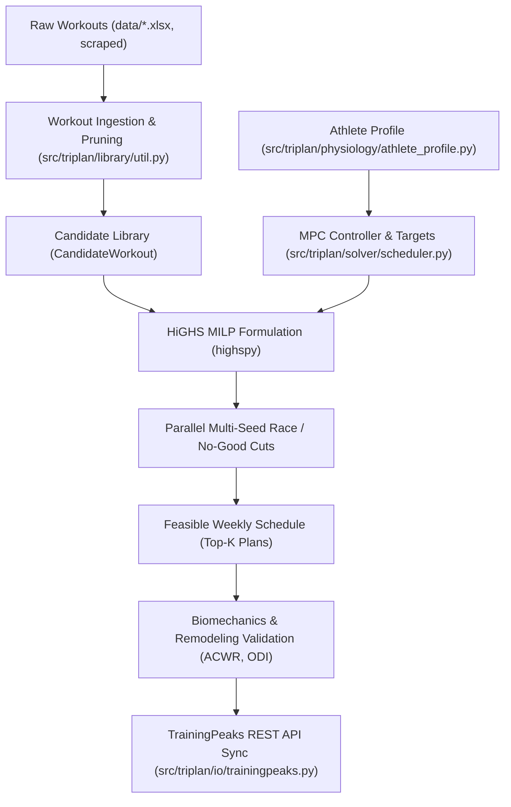

# Triathlon Workout & Hybrid Season Planner

[](https://www.python.org/)
[](https://highs.dev/)
[](https://www.8020endurance.com/)
[](docs/STATE_SUMMARY.md)

> [!CAUTION]
> **Medical & Coaching Disclaimer:** Workout plans and schedules synthesized by this platform are for analytical, experimental, and personal planning purposes. They do not constitute certified medical, coaching, or physical therapy advice. Endurance and heavy resistance training carry inherent risks; always monitor bodily biofeedback, recovery metrics, and subjective perception of fatigue.

> [!NOTE]
> **Historical Archive:** Looking for the original exploratory Monte Carlo prototype documentation? See the [Archived Legacy ReadMe](docs/archive/README_LEGACY.md).

---

## 1. System Overview

The **Triathlon Workout & Hybrid Season Planner** is a high-performance mathematical modeling and closed-loop scheduling platform. It combines empirical **80/20 endurance principles** (Stephen Seiler, Matt Fitzgerald, Joe Friel) and **Hybrid Athlete strength science** with **Mixed-Integer Linear Programming (MILP)** and **Model Predictive Control (MPC)** to synthesize optimal, injury-resistant multi-sport schedules balancing **Swimming**, **Cycling**, **Running**, **Brick Transitions**, and **Barbell/Dumbbell Strength Training**.

Originally conceived as a Monte Carlo random workout selector, the system has evolved into an industrial-grade planning engine solving complex multi-discipline combinatorial optimization problems in **sub-second time** using the C++ HiGHS solver (`highspy`).

### Core Technology Stack
- **MILP Optimization Engine:** [HiGHS](https://highs.dev/) via `highspy` (Branch-and-Cut, Simplex, Interior Point).
- **Core Pipeline:** Python 3.10+, `pandas`, `numpy`, `openpyxl`, `polars`.
- **Integrations:** TrainingPeaks Private REST API, Garmin Connect / FIT file parser, 80/20 Endurance Library scraper.
- **Lineage & Governance:** SQLite WAL + FTS5 BM25 progressive disclosure engine (`scripts/lodectx.py`).

---

## 2. Key Capabilities & Architectural Evolutions



### A. Sub-Second Deterministic MILP Solving
- **From 11.4 Million Years to < 0.25 Seconds:** Replaced combinatorial brute-force and unconstrained random sampling with mathematical Mixed-Integer Linear Programming.
- **15-Seed Parallel Race:** Spawns 15 randomized solver seeds across worker threads to overcome branch-and-cut symmetry and find optimal schedules in tens of milliseconds.
- **Canonical No-Good Integer Cuts:** Top-$K$ alternative schedules are generated using strict integer exclusion cuts ($\sum_{w \in S_k} x_{w,d} \le |S_k| - 1$), guaranteeing provable structural uniqueness rather than superficial variations.

### B. True Multi-Sport & Hybrid Athlete Support
- **Full Triathlon Spectrum:** Native support for Swim, Bike, Run, and Brick (bike-to-run transition) workouts.
- **Barbell & Dumbbell Strength Integration:** 15 modular blueprint strength templates incorporating Olympic barbell compound lifts (Squat, Deadlift, Bench Press, Overhead Press) and dumbbell hypertrophy assistance.
- **Equipment Set Partitioning:** Enforces $\ge 60\%$ weekly strength volume on Olympic barbell compound movements, reserving dumbbells for unilateral hypertrophy and assistance.
- **Movement Pattern Balance:** Balances all 4 core human movement patterns (Anterior Chain, Posterior Chain, Push, Pull) with minimum volume constraints (10+ sets/week).

### C. Advanced Physiological Modeling & Biomechanical Safety
- **Dual-Load Tracking (Aerobic TSS vs. Mechanical Strain):** Decouples cardiovascular load (TSS) from musculoskeletal impact shock ($S_{\text{mech}}$).
- **Asynchronous Tissue Remodeling:** Accurately models the disparate adaptation time-constants of vascularized cardiovascular tissue ($\tau = 35\text{ days}$) versus poorly vascularized collagenous tendon/cartilage matrix ($\tau = 120\text{ days}$).
- **Orthopedic Dissociation Index (ODI):** Restricts the ratio of the 35-day to the 120-day running-strain EWMA ($ODI^{run} \le 1.35$) to prevent aerobic overreach injuries.
- **Single-Run Ceiling:** Strictly caps any single run at $\le 32\%$ of total weekly running duration (`ADR-003`) to eliminate long-run orthopedic spikes.
- **Biomechanical Conflict Matrix:**
  - **Deadlift-Run 24h Lockout:** Prevents heavy deadlifts and threshold/long runs from occurring within 24 hours of each other to protect against lumbar shear fatigue. Deadlifts stack synergistically with swimming.
  - **Squat vs. Threshold Run / High-Torque Bike:** Absolute same-day exclusion.
  - **Upper Press vs. CSS Threshold Swim:** Absolute same-day exclusion to prevent subacromial shoulder impingement.
- **Load Ceilings:** Strict daily and weekly caps on axial spinal load ($X_{\text{day}} \le 120$, $X_{\text{wk}} \le 320$), neuromuscular fatigue ($N_{\text{day}} \le 130$, $N_{\text{wk}} \le 360$), and rolling 48-hour mechanical strain ($\le 260$).
- **EWMA Mechanical ACWR:** Maintains Acute-to-Chronic Workload Ratio for running strain strictly within $[0.80, 1.30]$.
- **ANS Costing:** Accounts for Autonomic Nervous System fatigue with the `SPEC.md` 7-zone weight vector $(0, 0, 0.7, 1.0, 1.4, 1.8, 3.5)$ (alactic strides exempt) plus a long-duration surcharge (`ADR-034`).
- **Hard-Days-Hard & Molecular Signaling:** Preserves easy days for systemic restoration; stacks strength workouts on hard endurance days with $\ge 6\text{ hours}$ intra-day separation to avoid AMPK vs. mTORC1 signaling interference.

### D. Three-Tier Closed-Loop Model Predictive Control (MPC)
- **Tier 1 (Daily Auto-Regulation):** Modulates daily training prescriptions based on morning Garmin readiness ($\alpha_d$), evaluating rMSSD HRV Z-scores, resting heart rate drift, and sleep scores. Autonomously downgrades high-intensity sessions or converts to active recovery on suppressed days.
- **Tier 2 (Weekly Dynamic 1RM Updating):** Dynamically estimates 1-Rep Max (e1RM) across main lifts using a recursive Kalman filter updating from completed repetitions, weights, and Reps-In-Reserve (RIR).
- **Tier 3 (Mesocycle Periodization):** Enforces 3:1 undulating step-cycles (Accumulation, Intensification, Peak Overload, Supercompensation Deload) with periodized intensity distribution shifting toward race specificity.

### E. Telemetry & Hardware Invariants
- **Stryd Footpod CIQ Ingestion:** Extracts Developer Field `Power` (`field.name == 'Power'`) from `.fit` files to prevent reading Garmin's native running power (which is inflated by +20% to +30%).
- **Swim Active Length Filtering:** Calculates swim duration and sTSS strictly from active pool lengths (`length_type == 'active'`), cleanly stripping wall rest intervals and drill artifacts.
- **Multi-Device Deduplication:** Automatically deduplicates dual-recorded rides between Garmin Edge 530 and Enduro 3 within 300-second windows.
- **Canonical 80/20 7-Zone Power Scale:** Prescriptions are mapped to the canonical 80/20 7-Zone Power Scale calibrated via Two-Point Critical Power testing ($P_3 + P_{12}$) or Kolie Moore MLSS baselines.

---

## 3. Side-by-Side Performance: HiGHS MILP vs. Monte Carlo

Benchmarked on an AMD Ryzen 9 5950X (32 logical threads) across 10,000 iterations:

| Metric | Original Monte Carlo Method | HiGHS MILP Multi-Seed Race | Improvement / Note |
| :--- | :--- | :--- | :--- |
| **Solve Latency** | ~30.00 – 60.00 seconds | **~0.08 – 0.25 seconds** | **> 200× faster** |
| **Optimality Guarantee** | None (Random Sampling) | **Provably Optimal (MILP)** | Mathematical optimality within gap tolerance |
| **Feasibility Guarantee** | Trial-and-error (~46% valid) | **100% Strict Hard Constraints** | All constraints guaranteed |
| **Top Schedule Score** | ~98.3 / 100 | **99.6+ / 100** | Consistently superior target alignment |
| **Candidate Pruning** | None (evaluates all unviable items) | **Automated Pre-Filtering** | Prunes non-viable candidates before solve |
| **Day-by-Day Scheduling** | None (unordered bag of workouts) | **Mon–Sun Fitzgerald Hard/Easy** | Automatic day, sport, and rest assignment |
| **Multi-Sport Balancing** | Bike & Run only | **Swim, Bike, Run, Brick, Strength** | Complete 4-sport hybrid optimization |
| **Tissue Remodeling / Safety** | None | **ACWR, ODI, Axial Caps, 24h Lockouts** | Clinical-grade injury prevention |

---

## 4. Repository Structure

```text
triathlon_planning/
├── .agents/                    # Multi-agent operating charters and engineering directives
│   ├── AGENTS.md
│   └── GEMINI.md
├── config/                     # Environment and credentials (gitignored secrets)
│   ├── .env.example
│   ├── trainingpeak.env
│   └── garmin.env
├── data/                       # Workout libraries and raw telemetry
│   ├── Bike.xlsx               # 80/20 Cycling workout catalog
│   ├── Run.xlsx                # 80/20 Running workout catalog
│   ├── Swim.xlsx               # 80/20 Swimming workout catalog
│   ├── brick_workouts.csv      # Transition workout matrices
│   └── fit_files/              # Raw FIT activity files
├── docs/                       # Progressive disclosure documentation & context engine
│   ├── archive/                # Historical ledger & archived legacy ReadMe
│   │   ├── README_LEGACY.md    # Original Monte Carlo ReadMe
│   │   └── DECISIONS_AND_HEURISTICS_LEDGER.md
│   ├── domains/                # Domain lodes (optimizer, mpc, physiology, safety, etc.)
│   ├── specs/                  # Engineering PRDs (PRD-001, PRD-002)
│   ├── INVARIANTS.md           # Non-negotiable system invariants
│   ├── LODE_MAP.md             # Routing index and ADR/Heuristic registry
│   ├── SPEC.md                 # Hardware telemetry & zone calibration spec
│   ├── STATE_SUMMARY.md        # System architecture and module boundaries
│   └── TASKS.md                # Active task queue
├── references/                 # Physiological textbooks and literature
├── scripts/                    # Operational tooling and benchmarks
│   ├── benchmark_scaling.py    # Multi-core scaling benchmarks
│   ├── compare_all_plans.py    # Multi-plan comparator
│   ├── generate_level0_hybrid_20w.py  # 20-week production hybrid plan synthesizer
│   ├── lodectx.py              # SQLite WAL + FTS5 Lineage Engine CLI
│   └── sync_garmin_data.py     # Garmin telemetry synchronization
├── src/triplan/                # Core Python package (src-layout, ADR-015)
│   ├── model/                  # candidates.py (CandidateWorkout, MesoCycleTargetsAndConstraints), classes.py
│   ├── library/                # schema.py, build.py, loader.py, candidates.py, clean_file.py, util.py
│   ├── solver/                 # scheduler.py, hybrid.py, pruning.py, highs_optimization.py, safety_constraints.py, highs_runtime.py
│   ├── physiology/             # athlete_profile.py, state.py (AthletePhysiologicalState)
│   ├── control/                # mpc.py (ClosedLoopMPCController), season.py (season generator)
│   ├── io/                     # trainingpeaks.py (TrainingPeaks REST sync)
│   ├── perf/                   # stress.py (11-scenario adversarial stress suite)
│   └── cli.py                  # Primary orchestration pipeline (`triplan` / `python -m triplan`)
├── training_plans/             # Generated periodized season schedules (CSV & Markdown)
├── pyproject.toml              # Build configuration and single dependency source
├── requirements.txt            # Thin pointer to `-e .[test,garmin]` (deps live in pyproject.toml)
└── ReadMe.md                   # Primary system documentation (this file)
```

---

## 5. Getting Started

### Prerequisites
- Python 3.10+ (tested on Python 3.10, 3.11, 3.12, 3.14+)
- C++ HiGHS solver binaries (automatically installed via `pip install highspy`)

### Installation

1. **Clone the repository:**
   ```bash
   git clone https://github.com/your-username/triathlon_planning.git
   cd triathlon_planning
   ```

2. **Create and activate a virtual environment:**
   ```bash
   python -m venv .venv
   # Windows:
   .venv\Scripts\activate
   # Linux/macOS:
   source .venv/bin/activate
   ```

3. **Install dependencies:**
   ```bash
   pip install -e ".[test,garmin]"   # pyproject.toml is the single dependency source (ADR-015)
   ```

4. **Configure Environment Secrets (Optional for TrainingPeaks / Garmin sync):**
   ```bash
   cp config/.env.example config/.env
   # Edit config/.env with your credentials
   ```

---

## 6. Usage & Common Workflows

### A. Run the Full Optimization & Demonstration Suite
Execute the primary orchestration runner to generate sample single-week, 3-week step cycles, 16-week Olympic schedules, and hybrid athlete plans:
```bash
python -m triplan   # or: triplan
```

### B. Generate a 20-Week Hybrid Athlete Season Plan
Synthesizes a complete 20-week periodized schedule balancing Olympic triathlon preparation with Texas Method barbell wave progression:
```bash
python scripts/generate_level0_hybrid_20w.py
```

### C. Run the Scenario Stress Test Suite
Evaluates solver resilience and orthopedic constraint compliance against 11 challenging physiological scenarios:
```bash
python -m triplan.perf.stress
```

### D. Benchmark Multi-Core Scaling
Benchmark HiGHS solver scaling and thread utilization across your CPU cores:
```bash
python scripts/benchmark_scaling.py
```

### E. Query the SQLite Lineage & Context Engine (`lodectx.py`)
Inspect system lineage, search architectural decisions, view domain briefs, or verify context token budgets:
```bash
# Verify startup token budget (< 7,500 tokens)
python scripts/lodectx.py stats

# View a domain briefing (e.g., optimizer, physiology, safety, integrations)
python scripts/lodectx.py brief optimizer

# Trace an Architectural Decision Record or Heuristic
python scripts/lodectx.py trace ADR-008
```

---

## 7. Governing Architecture Decision Records (ADRs)

| ADR | Domain | Title | Summary |
| :--- | :--- | :--- | :--- |
| [`ADR-001`](docs/LODE_MAP.md#3-architectural-decisions-index-adr) | `general` | Progressive Disclosure & SQLite Lineage | Establishes startup token budgets and SQLite lineage tracking. |
| [`ADR-002`](docs/LODE_MAP.md#3-architectural-decisions-index-adr) | `optimizer` | HiGHS MILP Solver Adoption | Adopts `highspy` C++ solver, replacing Monte Carlo sampling. |
| [`ADR-003`](docs/LODE_MAP.md#3-architectural-decisions-index-adr) | `safety` | Single-Run Volume Ceiling ($\le 32\%$) | Enforces strict bound on long run duration to protect bone/connective tissue. |
| [`ADR-004`](docs/LODE_MAP.md#3-architectural-decisions-index-adr) | `physiology` | Dual-Load Decoupling & Tissue Remodeling | Decouples Aerobic TSS from Mechanical Strain; models $\tau=35\text{d}$ vs $\tau=120\text{d}$. |
| [`ADR-005`](docs/LODE_MAP.md#3-architectural-decisions-index-adr) | `mpc` | Three-Tier Closed-Loop MPC | Establishes Daily ($\alpha_d$), Weekly (Kalman e1RM), and Mesocycle (3:1) control. |
| [`ADR-006`](docs/LODE_MAP.md#3-architectural-decisions-index-adr) | `perf` | 15-Seed Parallel HiGHS Race | Exploits CPU concurrency to solve diverse MILP schedules under 4 seconds. |
| [`ADR-008`](docs/LODE_MAP.md#3-architectural-decisions-index-adr) | `optimizer` | Dual-Objective Hybrid Optimization | Barbell/Dumbbell partitioning, movement balance, and biomechanical conflict matrix. |
| [`ADR-009`](docs/LODE_MAP.md#3-architectural-decisions-index-adr) | `physiology` | 80/20 7-Zone Power & Two-Point CP | Mandates canonical 80/20 zones; establishes $P_3+P_{12}$ Two-Point CP protocol. |
| [`ADR-010`](docs/LODE_MAP.md#3-architectural-decisions-index-adr) | `integrations` | Multi-Device Hardware Telemetry | Establishes Stryd CIQ Developer field extraction and 300s ride deduplication. |
| [`ADR-011`](docs/LODE_MAP.md#3-architectural-decisions-index-adr) | `physiology` | CP Retesting Engine & Telemetry Triggers | Mesocycle-synchronized threshold calibration with telemetry-driven triggers. |

---

## 8. License & Acknowledgements

- **Workout Principles & Structure:** Inspired by and compliant with the methodologies outlined by Dr. Stephen Seiler, Matt Fitzgerald (*80/20 Triathlon*, *80/20 Running*), and Joe Friel (*The Triathlete's Training Bible*).
- **Optimization Engine:** Powered by the open-source [HiGHS](https://highs.dev/) mathematical optimization software.
