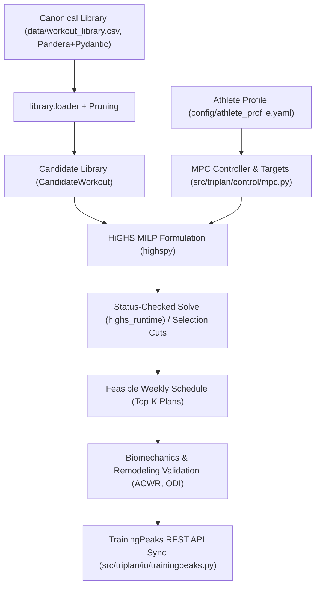

# System State Summary (`docs/STATE_SUMMARY.md`)

## 1. System Overview & Architecture
The **Triathlon Workout & Season Planner** is a high-performance mathematical modeling and closed-loop scheduling platform. It combines empirical **80/20 endurance principles** (Seiler, Fitzgerald, Friel) and **Hybrid Athlete strength science** with **Mixed-Integer Linear Programming (MILP)** and **Model Predictive Control (MPC)** to synthesize optimal, injury-resistant multi-sport schedules balancing Running, Cycling, Swimming, and Barbell/Dumbbell lifting.

- **Primary Stack:** Python 3.14+, `highspy` (HiGHS C++ MILP solver), `pandas`, `numpy`, `openpyxl`.
- **Integrations:** TrainingPeaks Private REST API, Garmin Health API / Connect, 80/20 Endurance Library scraper. *(Recorded-activity FIT parsing is specified in `SPEC.md`/`ADR-010` but **not yet implemented** — `TASK-024`.)*
- **Lineage & Context Engine:** SQLite WAL + FTS5 BM25 (`docs/.context/lode.db`) managed via `scripts/lodectx.py`.
- **Primary Data Sources:** `data/workout_library.csv` (single validated workout library, 7-zone, explicit flags; `ADR-014`) and `config/athlete_profile.yaml` (validated athlete profile). `data/{Run,Bike,Swim}.xlsx` are the raw 80/20 scrape cache, read only at build time.

## 2. Core Subsystems & Module Boundaries
Domain → module routing lives in `CLAUDE.md` §5 and `docs/LODE_MAP.md`; per-domain detail in `docs/domains/<domain>.md`. Summary:

| Subsystem | Package (`src/triplan/`) | Responsibility |
| :--- | :--- | :--- |
| `optimizer` | `solver/`, `model/` | One unified HiGHS week engine (`solver/engine/`: `WeekModel` + modular builders, `ADR-017`; scheduler/hybrid/day-scheduler are thin facades), pruning, selection cuts, symmetry breaking, equipment partitioning. |
| `safety` | `solver/safety_constraints.py` | Shared Tier-0 orthopedic layer (`ADR-013`): run ceiling, DL lockout, axial/NM/strain caps, ACWR, ODI. |
| `mpc` | `control/` | 3-tier closed loop (`ADR-005`), season generation. |
| `physiology` | `physiology/` | Athlete profile (YAML), PMC + tissue-remodeling state, ANS cost. |
| `workouts` | `library/` | Canonical library load/validate/build (`ADR-014`), 7-zone conversions, strength blueprints. |
| `integrations` | `io/`, `library/clean_file.py` | TrainingPeaks sync, 80/20 scrape. Activity FIT parser **not implemented** (`TASK-024`). |
| `perf` | `perf/` | 11 stress scenarios, core-scaling benchmarks. |

## 3. Data Pipeline & Optimization Flow

## 4. Directory & Repository Topology (`ADR-007`, `ADR-015`)
- `src/triplan/`: installable package (`pip install -e ".[test]"`); `paths.py` anchors all file I/O to the repo root; `cli.py` / `python -m triplan`.
- `tests/`: pytest suite; known engine defects are `xfail`s naming their owning task.
- `config/`: `athlete_profile.yaml` + gitignored credential `.env` files. `data/`: `workout_library.csv`, raw 80/20 scrape cache, gitignored telemetry (`garmin/`, `lifting/`).
- `docs/`: startup core, `BACKLOG.md` (full task specs), `domains/`, `lode/` (ADR/HEUR), `specs/` (PRD), `experiments/`, `archive/`, `.context/lode.db`.
- `scripts/`: `lodectx.py`, benchmarks, plan comparators. `training_plans/`: generated season CSVs + race-distance specs. `references/`: literature (binaries gitignored).
- Root: `pyproject.toml` (sole dependency source), `SPEC.md`, `CLAUDE.md` → `GEMINI.md` charter (also symlinked under `.agents/`).
