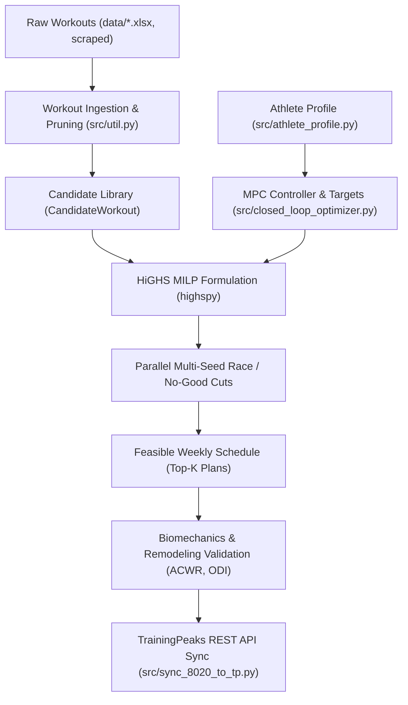

# System State Summary (`docs/STATE_SUMMARY.md`)

## 1. System Overview & Architecture
The **Triathlon Workout & Season Planner** is a high-performance mathematical modeling and closed-loop scheduling platform. It combines empirical **80/20 endurance principles** (Seiler, Fitzgerald, Friel) and **Hybrid Athlete strength science** with **Mixed-Integer Linear Programming (MILP)** and **Model Predictive Control (MPC)** to synthesize optimal, injury-resistant multi-sport schedules balancing Running, Cycling, Swimming, and Barbell/Dumbbell lifting.

- **Primary Stack:** Python 3.14+, `highspy` (HiGHS C++ MILP solver), `pandas`, `numpy`, `openpyxl`.
- **Integrations:** TrainingPeaks Private REST API, Garmin Health API / Connect, 80/20 Endurance Library scraper, FIT file parser.
- **Lineage & Context Engine:** SQLite WAL + FTS5 BM25 (`docs/.context/lode.db`) managed via `scripts/lodectx.py`.
- **Primary Data Sources:** `data/Bike.xlsx`, `data/Run.xlsx`, `data/Swim.xlsx`, `data/brick_workouts.csv`.

## 2. Core Subsystems & Module Boundaries

| Subsystem | Primary Modules | Key Responsibilities |
| :--- | :--- | :--- |
| `optimizer` | [`src/highs_optimization.py`](file:///C:/Users/drisc/PycharmProjects/triathlon_planning/src/highs_optimization.py), [`src/closed_loop_optimizer.py`](file:///C:/Users/drisc/PycharmProjects/triathlon_planning/src/closed_loop_optimizer.py) | HiGHS MILP formulations, candidate pruning, multi-seed parallel race, and `HybridAthleteMILPOptimizer` (4-sport balancing, equipment set partitioning, biomechanical conflict matrix, Canonical No-Good Integer Cuts). |
| `mpc` | [`src/closed_loop_optimizer.py`](file:///C:/Users/drisc/PycharmProjects/triathlon_planning/src/closed_loop_optimizer.py) | 3-tier closed-loop Model Predictive Control: Tier 1 Garmin morning readiness scalar ($\alpha_d$), Tier 2 e1RM Kalman filtering, Tier 3 3:1 mesocycle wave undulation. |
| `physiology` | [`src/athlete_profile.py`](file:///C:/Users/drisc/PycharmProjects/triathlon_planning/src/athlete_profile.py), [`src/classes.py`](file:///C:/Users/drisc/PycharmProjects/triathlon_planning/src/classes.py) | Dual-load modeling (Aerobic TSS vs Mechanical Strain), ANS costing ($e^{0.65(z-1)}$), asynchronous tissue remodeling ($\tau=35d$ vs $\tau=120d$), and movement-pattern tracking (Anterior/Posterior Chain, Push, Pull). |
| `workouts` | [`src/util.py`](file:///C:/Users/drisc/PycharmProjects/triathlon_planning/src/util.py), [`src/classes.py`](file:///C:/Users/drisc/PycharmProjects/triathlon_planning/src/classes.py) | 80/20 workout library loading, canonical 80/20 7-zone power/pace/CSS conversions, duration and TSS standardization, brick synthesis, and hybrid strength library (15 blueprint templates). |
| `integrations` | [`src/sync_8020_to_tp.py`](file:///C:/Users/drisc/PycharmProjects/triathlon_planning/src/sync_8020_to_tp.py), [`src/clean_file.py`](file:///C:/Users/drisc/PycharmProjects/triathlon_planning/src/clean_file.py) | TrainingPeaks private API sync, workout structure serialization, HTML scraping, multi-device FIT parser (Stryd CIQ developer power, Swim active lengths, 300s ride deduplication, Neo 2T slope mode). |
| `safety` | [`src/closed_loop_optimizer.py`](file:///C:/Users/drisc/PycharmProjects/triathlon_planning/src/closed_loop_optimizer.py) | Single-run volume ceiling ($\le 32\%$), 24h deadlift-run buffer, axial spinal load caps ($X_{\text{day}} \le 120, X_{\text{wk}} \le 320$), neuromuscular fatigue caps, rolling 48h mechanical strain caps, mechanical ACWR $\le 1.30$, ODI $\le 1.35$. |
| `perf` | [`src/stress_test_optimizer.py`](file:///C:/Users/drisc/PycharmProjects/triathlon_planning/src/stress_test_optimizer.py) | Parallel core scaling benchmarks (1-32 cores), solver timeout enforcement, and scenario resilience testing (11 stress scenarios). |

## 3. Data Pipeline & Optimization Flow

## 4. Directory & Repository Topology
- `src/`: Core Python platform package (`classes.py`, `closed_loop_optimizer.py`, `highs_optimization.py`, `athlete_profile.py`, `main.py`, `stress_test_optimizer.py`, `clean_file.py`, `sync_8020_to_tp.py`, `util.py`, `__init__.py`).
- `config/`: Secure environment files (`.env.example`, `trainingpeak.env`, `garmin.env`). All secret `.env` files are gitignored.
- `.agents/`: Agent charters and operational rules (`AGENTS.md`, `CLAUDE.md`, `GEMINI.md`, `rules/operating_charter.md`).
- `data/`: Structured workout matrices (`Bike.xlsx`, `Run.xlsx`, `Swim.xlsx`, `brick_workouts.csv`), scrape caches (`workout_library.html`), JSON preview payloads (`parsed_workouts_preview.json`), and raw FIT downloads (`fit_files/`).
- `docs/`: Progressive disclosure core, domain briefing lodes, ADRs, PRDs, heuristics, hardware/threshold specification (`SPEC.md`), and SQLite lineage DB (`.context/lode.db`).
- `references/`: Empirical endurance literature, textbooks, and physiological research documents (large binaries gitignored).
- `scripts/`: Operational tools, SQLite lineage engine (`lodectx.py`), core scaling benchmarks, and multi-plan simulation comparators.
- `training_plans/`: Periodized season output schedules (`.csv`) and canonical race distance specifications (`.md`).
- Project Root: Packaging specification (`pyproject.toml`), dependencies (`requirements.txt`), telemetry specification (`SPEC.md`), repository README (`ReadMe.md`), and `.gitignore`.

