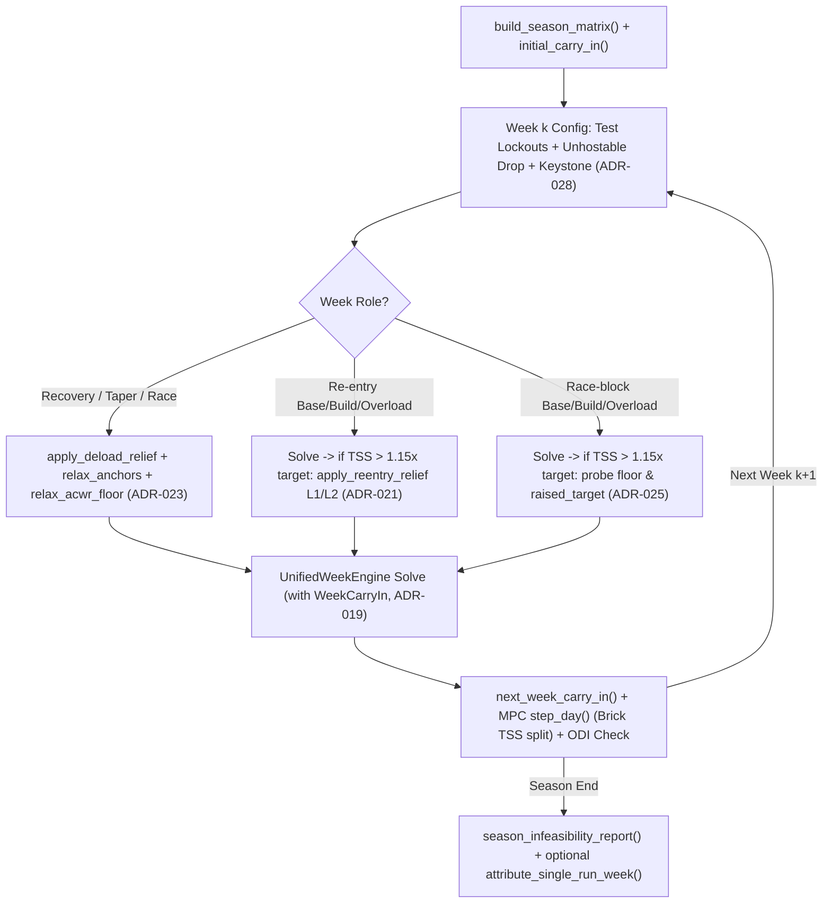

# Domain Lode: `mpc`

## 1. Scope & Responsibility
Three-tier Closed-Loop Model Predictive Control (`ADR-005`), generated 3:1 mesocycle season matrices and CP test lockouts (`TASK-026`, `ADR-011`), cross-week state carry-in (`ADR-019`), long-course alternating keystones (`ADR-028`), deload/re-entry/structural-floor target policies (`ADR-021`, `ADR-023`, `ADR-025`), and season-level infeasibility & single-run attribution diagnostics (`TASK-027`, `TASK-046`).

## 2. Key Modules & Entrypoints
- [`src/triplan/control/mpc.py`](file:///C:/Users/drisc/PycharmProjects/triathlon_planning/src/triplan/control/mpc.py): `ClosedLoopMPCController`, unified Tier-1 daily readiness scaling ($\alpha_d \in [0.60, 1.00]$), `reoptimize_remaining_week()` intra-week receding-horizon re-solve, `advance_state_from_actuals()`, Tier-2 e1RM Kalman filtering, and weekly execution recalibration.
- [`src/triplan/control/actuals.py`](file:///C:/Users/drisc/PycharmProjects/triathlon_planning/src/triplan/control/actuals.py): `ActualsStore` and `CompletedActivity` persisting realized activities with 7-zone TiZ, TSS, ANS cost, and mechanical strain to advance `AthletePhysiologicalState` from actuals (`TASK-025`).
- [`src/triplan/io/garmin_wellness.py`](file:///C:/Users/drisc/PycharmProjects/triathlon_planning/src/triplan/io/garmin_wellness.py): `WellnessSnapshot` and `compute_wellness_snapshot()` reading `data/garmin/wellness/{hrv_summaries,daily_summaries,sleep_summaries}.json` (28-day rolling HRV rMSSD & RHR mean/SD + sleep score) into unified $\alpha_d$.
- [`src/triplan/control/periodization.py`](file:///C:/Users/drisc/PycharmProjects/triathlon_planning/src/triplan/control/periodization.py): `build_season_matrix()` (3:1 cycles + optional re-entry block), `SeasonWeek` (`config_phase`), `is_cp_test_allowed()` / `filter_test_workouts()`, `drop_unhostable_long_sessions()`, `apply_deload_relief()` / `relax_deload_anchors()` / `relax_deload_acwr_floor()`, `apply_reentry_relief()`, `raised_target()` (`FLOOR_PROBE_TARGET`), `apply_keystone_week()` (`KEYSTONE_RUN_CODES`, `keystone_kind`, `keystone_run_rungs`, `KEYSTONE_RIDE_CODES`, `keystone_ride_rungs`, `keystone_ride_minutes`), `apply_keystone_run_support()` (`TASK-062`), and `progression_guard_bounds()` (`PROGRESSION_GUARD_WINDOW`, `ADR-031`).
- [`src/triplan/control/carry.py`](file:///C:/Users/drisc/PycharmProjects/triathlon_planning/src/triplan/control/carry.py): `initial_carry_in()`, `load_state_for_week()`, and `next_week_carry_in()` bridging Saturday/Sunday loads, EWMA ACWR, CTL/ATL, and `prev_longest_run_min` across weeks (`ADR-019`, `ADR-022`, `TASK-045`, `TASK-049`).
- [`src/triplan/control/season.py`](file:///C:/Users/drisc/PycharmProjects/triathlon_planning/src/triplan/control/season.py): `generate_closed_loop_season_schedule()`, `WeekRecord`, and `format_plan_to_dataframe()` (records `Run_Mech_Strain` alongside `Total_Mech_Strain`).
- [`src/triplan/control/feasibility.py`](file:///C:/Users/drisc/PycharmProjects/triathlon_planning/src/triplan/control/feasibility.py): `time_budget_diagnosis()`, `season_infeasibility_report()`, `attribute_single_run_week()` (`TASK-046`), and `attribute_keystone_run_week()` (`TASK-062`).
- [`src/triplan/physiology/state.py`](file:///C:/Users/drisc/PycharmProjects/triathlon_planning/src/triplan/physiology/state.py): `AthletePhysiologicalState` (Banister CTL/ATL/TSB, run-strain ODI $F(t)/S(t)$, EWMA running ACWR, `step_day()`).
- [`src/triplan/cli.py`](file:///C:/Users/drisc/PycharmProjects/triathlon_planning/src/triplan/cli.py): End-to-end CLI driver writing season summaries to `training_plans/`.

## 3. Closed-Loop Season & Weekly Control Workflow

### A. Tier 1: Daily Micro-Adjustments & Intra-Week Receding-Horizon Re-Solve (`TASK-025`, `TASK-003`)
Tier 1 scales intensity/duration from unified morning readiness $\alpha_d \in [0.60, 1.00]$ driven by Garmin nocturnal HRV rMSSD z-score, RHR z-score (using `rhr_baseline_std`), sleep score, and optional soreness / luteal phase adjustment:
$$\alpha_d = \text{clip}\!\left(1.00 + 0.08\,Z_{\text{hrv}} - 0.05\,Z_{\text{rhr}} + 0.04\,\frac{\text{Sleep} - 80}{20} + \text{Soreness},\; 0.60,\; 1.00\right)$$
- **Red Alert ($\alpha_d < 0.75$):** Converts hard endurance / heavy axial strength to Zone 1 Active Recovery (0.50x duration) or mobility decompression.
- **Amber / Yellow Caution ($0.75 \le \alpha_d < 0.95$):** Scales interval/working load and daily cap by $\alpha_d$.
- **Green Nominal ($\alpha_d \ge 0.95$):** Executes as prescribed.
- **Intra-Week Receding-Horizon Re-Solve:** `ClosedLoopMPCController.reoptimize_remaining_week()` fixes completed days $d < \text{today}$ via `UnifiedWeekEngine(..., fixed_days=..., disallowed_hard_days=...)` (`calendar.add_fixed_days()`), protects `today` if $\alpha_d < 0.75$, and re-optimizes remaining days $d \ge \text{today}$ under all Tier-0/1/2 constraints. `ActualsStore.advance_state()` advances `AthletePhysiologicalState` day-by-day from stored actuals.

### B. Tier 2: Cross-Week Carry-In & In-Model Load Dynamics (`ADR-019`)
Instead of post-hoc weekly strain throttling, `control/carry.py` passes `WeekCarryIn` from week $k$ to week $k+1$:
1. **Boundary Continuity:** Saturday/Sunday flags (hard day, heavy/long run, deadlift, strength) and loads (TSS, ANS, strain) become fixed constants for Monday's (`d=0`) adjacency and rolling 48h rows.
2. **In-Model Linearized Running ACWR & Ramp:** Daily EWMA acute/chronic loads ($A_d - \rho C_d \le \varepsilon$, $\rho = 1.20$ while `LoadState.reentry` is active i.e. `reentry_phase=True` and run CTL `< 15`, else `1.25`, or `1.15` for Masters), `max_weekly_ctl_ramp` (`7.0`, `5.0` Masters), and the re-entry run-minutes guard (`max(60, prev + 15)`) live directly inside `builders/load_dynamics.py`, together with the run-strain ODI ceiling $F_d - \rho_{\text{odi}} S_d \le \varepsilon$ (`ADR-035`, `TASK-022`; $\rho_{\text{odi}} = 1.35$, $1.20$ Masters).
3. **Longest-Run Memory & Brick Splitting:** `WeekCarryIn.prev_longest_run_min` (seeded by `AthleteProfile.starting_longest_run_min`, `TASK-045`) tracks the `ADR-022` minute cap across run-free weeks. In `control/season.py`, `step_day` splits Bike→Run `Brick` TSS proportionally between Bike and Run PMCs (`ADR-030`).
4. **e1RM Kalman Filter:** Updates underlying barbell 1RM estimates using $\sigma_w = 0.5\text{ kg}$, $\sigma_v = 3.5\text{ kg}$ to track strength progression without overreacting to single-day noise.

### C. Tier 3: Generated Season Matrices, Keystones & Target Policies
1. **Generated 3:1 Matrices (`control/periodization.py`):** `build_season_matrix` generates sprint (12w), olympic (16w), 70.3 (20w), and ironman (24w) seasons from `mesocycle_build_weeks` / `mesocycle_recovery_weeks` (recovery = 70% of prior build week, followed by taper + race week), optionally prepended by `reentry_weeks` (24w for `CURRENT_ATHLETE`: no swim, 0 heavy lifts, `reentry=True`).
2. **CP Test Lockouts (`ADR-011`):** `filter_test_workouts()` removes test workouts in week 1, taper/race weeks, re-entry lockouts (bike `<= 4w`, run `<= 6w`), non-recovery weeks, or within `cp_test_min_gap_weeks` (`8w`) of the prior same-sport test.
3. **Alternating Keystones in 70.3 / IM Builds (`ADR-028`, `TASK-055`, `TASK-062`):** Even race-block build/overload weeks require only the distance-aware long-run anchor (75–150 min ladder via `KEYSTONE_RUN_CODES`, stepping down a rung if unhostable); odd weeks require only the distance-aware long-ride anchor (`ADR-033`, `TASK-063`): 70.3 `180, 210, 210, 240, 240, 300` / Ironman `180, 210, 240, 300, 300, 360` min from `BIKE_DUR_OUT_DEF` + `BIKE_LC_OUT_*`, at most one library rung above the previous week's longest ride, clamped to day-cap-hostable rungs (180 min kept when none is hostable), with a one-rung step-down retry on `shorten_or_drop_anchor:Bike`. When a long-run keystone is `>= 90 min` (`ks_run >= 90.0`) and `>= 5` two-session windows exist, `apply_keystone_run_support()` allows up to `6` run sessions (from `5`) so 5 standalone runs + 1 short easy run/combo can reach the `281–328 min` required by the `32%` share ceiling without exceeding `max_weekly_run_mech_strain`; the season loop has no ODI throttle since `TASK-022` (`ADR-035`): $\text{ODI}^{\text{run}} \le 1.35$ is an in-model row, so run-keystone weeks need no bypass.
4. **Phase-Specific Target & Structure Policies:**
   - **Deloads (`ADR-023`):** Recovery/taper/race weeks relax key min to 0, halve Swim/Bike/Run minimums, make anchors optional, waive the ACWR `0.80` floor charge, and retain `recovery_week_strength_sessions` maintenance lifts.
   - **Re-entry Build Overshoot (`ADR-021`):** Re-entry base/build/overload weeks solving $> 1.15\times$ target step down through `apply_reentry_relief` level 1 (halved structure minimums, rest `<= 4`) and level 2 (key/stride min 0).
   - **Race-Block Build Overshoot (`ADR-025`):** Race-block base/build/overload weeks solving $> 1.15\times$ target preserve full structure by probing the structural floor (`FLOOR_PROBE_TARGET`), raising the week target to `max(matrix target, floor)`, and re-solving (`Target_TSS` and `StructFloor` recorded in summary).
5. **`Phase` Enum, TTE Progression, Variety & Walk-Jog Re-Entry Block (`TASK-023`, `ADR-036`):**
   - `model/phase.py::Phase` (`BASE | BUILD | OVERLOAD | RECOVERY | TAPER | RACE`, a `StrEnum`) is the week role. `SeasonWeek.role`, `to_mesocycle_config()` and `configure_mesocycle_phase()` take a `Phase`; free text only via `Phase.parse()` (exact normalized alias table incl. display names such as `"General Foundation"` -> `BASE` and step labels like `"Build (+10%)"`), which raises on unknown labels instead of the old substring fall-through to Build 1. `RACE` now shares the taper targets (it used to fall through to Build 1).
   - `tte_mode_for(role)`: base/build/overload `progress`, recovery `deload`, taper/race `off`. `control/carry.py::next_week_carry_in(..., deload=)` hands the solver `prev_tte_min`, `tte_ref_min` (last non-deload solved week) and the last `VARIETY_MEMORY_WEEKS = 4` weeks of key codes; the season summary records `TTE_Min`, `TTE_Ref`, `TTE_Mode`.
   - **Walk-jog ladder (`control/periodization.py`):** while the in-model re-entry flag holds (`profile.reentry_phase` and run CTL below the exit), `next_walkjog_stage()` climbs `WALKJOG_LADDER` (1:1 x 20 min, 2:1 x 25, 3:1 x 30, 4:1 x 35) one rung per base/build/overload week, holds in deload weeks and resets to 0 once re-entry ends; `cfg.walkjog_stage` and the `WalkJog` summary column expose it. The `RUN_RW_*` library rows that realise the rungs, with strain from `physiology/load_model.run_walk_mechanical_strain`, landed in `TASK-058` (`ADR-037`): `filter_walkjog_workouts()` offers a row only at a rung that allows its run share and length (none at rung 0) and only removes candidates.
6. **Diagnostics (`control/feasibility.py`):** Attaches `summary.attrs["infeasibility"]` explaining time-budget limits, Tier-1 relaxations, raised targets, and (when `diagnose_single_run=True`) per-week single-run binding causes (`attribute_single_run_week`).

<!-- LODE_AUTOGEN_START -->
<!-- Auto-rendered by lodectx.py sync-docs; edit narrative sections above, not this block. -->

## Registered Lineage (`mpc`)

### Active Architectural Decisions (`ADR`)
- **`ADR-005` — Implement Three-Tier Closed-Loop Model Predictive Control with Daily Readiness Scaling:** Structure scheduling across Tier-1 daily morning readiness, Tier-2 weekly receding horizon, and Tier-3 mesocycle step cycles.
- **`ADR-012` — Lock Athlete Decision Record for Nov 2026 Re-Entry and Olympic Season:** Athlete inputs DECISION-001..020 are settled; src/athlete_profile.py is the source of truth. Re-verify on 2027-05-15 (time budget, pool access).
- **`ADR-019` — Carry-in state and in-model linearized running ACWR, CTL ramp and run-minutes rows:** Week k+1 is solved with week k's boundary days and EWMA state as constants; running ACWR (A - rho*C <= eps), CTL ramp and re-entry run minutes are in-model rows.
- **`ADR-028` — Alternating long-run / long-ride keystone weeks in long-course race-block builds:** 70.3/IM race-block build/overload weeks alternate a long-run and a long-ride mandatory anchor; deload roles keep ADR-023; Tier-0 never moves.
- **`ADR-033` — Distance-aware long-ride keystone ladder in long-course builds:** 70.3/IM long-ride keystone weeks climb 180->210-300/360 min (BIKE_LC_OUT_*), one rung above the last ride, step-down on a dropped Bike anchor.
- **`ADR-036` — Interval-parsed durability, TTE progression and variety goals, Phase enum, walk-jog re-entry block:** Durability = f(parsed intervals); week phase is a Phase enum, never a substring.
<!-- LODE_AUTOGEN_END -->
