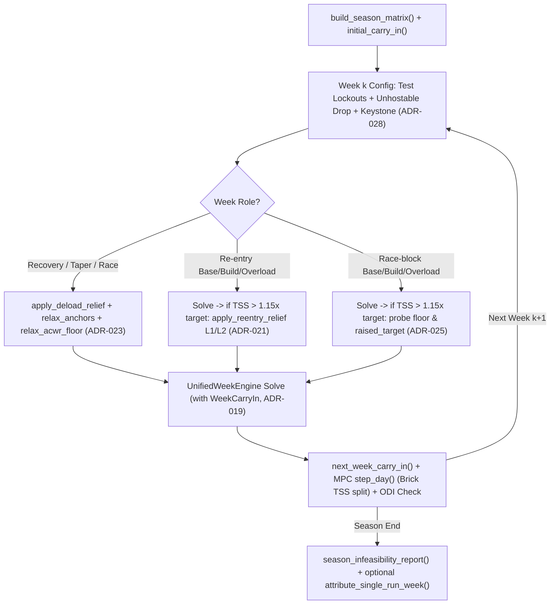

# Domain Lode: `mpc`

## 1. Scope & Responsibility
Three-tier Closed-Loop Model Predictive Control (`ADR-005`), generated 3:1 mesocycle season matrices and CP test lockouts (`TASK-026`, `ADR-011`), cross-week state carry-in (`ADR-019`), long-course alternating keystones (`ADR-028`), deload/re-entry/structural-floor target policies (`ADR-021`, `ADR-023`, `ADR-025`), and season-level infeasibility & single-run attribution diagnostics (`TASK-027`, `TASK-046`).

## 2. Key Modules & Entrypoints
- [`src/triplan/control/mpc.py`](file:///C:/Users/drisc/PycharmProjects/triathlon_planning/src/triplan/control/mpc.py): `ClosedLoopMPCController`, Tier-1 daily readiness scaling (`apply_tier1_daily_readiness()`), Tier-2 e1RM Kalman filtering, compliance / moderate-intensity rut detection, and weekly execution recalibration.
- [`src/triplan/control/periodization.py`](file:///C:/Users/drisc/PycharmProjects/triathlon_planning/src/triplan/control/periodization.py): `build_season_matrix()` (3:1 cycles + optional re-entry block), `SeasonWeek` (`config_phase`), `is_cp_test_allowed()` / `filter_test_workouts()`, `drop_unhostable_long_sessions()`, `apply_deload_relief()` / `relax_deload_anchors()` / `relax_deload_acwr_floor()`, `apply_reentry_relief()`, `raised_target()` (`FLOOR_PROBE_TARGET`), `apply_keystone_week()` (`KEYSTONE_RUN_CODES`, `keystone_kind`, `keystone_run_rungs`), `apply_keystone_run_support()` (`TASK-062`), and `progression_guard_bounds()` (`PROGRESSION_GUARD_WINDOW`, `ADR-031`).
- [`src/triplan/control/carry.py`](file:///C:/Users/drisc/PycharmProjects/triathlon_planning/src/triplan/control/carry.py): `initial_carry_in()`, `load_state_for_week()`, and `next_week_carry_in()` bridging Saturday/Sunday loads, EWMA ACWR, CTL/ATL, and `prev_longest_run_min` across weeks (`ADR-019`, `ADR-022`, `TASK-045`, `TASK-049`).
- [`src/triplan/control/season.py`](file:///C:/Users/drisc/PycharmProjects/triathlon_planning/src/triplan/control/season.py): `generate_closed_loop_season_schedule()`, `WeekRecord`, and `format_plan_to_dataframe()` (records `Run_Mech_Strain` alongside `Total_Mech_Strain`).
- [`src/triplan/control/feasibility.py`](file:///C:/Users/drisc/PycharmProjects/triathlon_planning/src/triplan/control/feasibility.py): `time_budget_diagnosis()`, `season_infeasibility_report()`, `attribute_single_run_week()` (`TASK-046`), and `attribute_keystone_run_week()` (`TASK-062`).
- [`src/triplan/physiology/state.py`](file:///C:/Users/drisc/PycharmProjects/triathlon_planning/src/triplan/physiology/state.py): `AthletePhysiologicalState` (Banister CTL/ATL/TSB, $M(t)/C(t)$ ODI, EWMA running ACWR, `step_day()`).
- [`src/triplan/cli.py`](file:///C:/Users/drisc/PycharmProjects/triathlon_planning/src/triplan/cli.py): End-to-end CLI driver writing season summaries to `training_plans/`.

## 3. Closed-Loop Season & Weekly Control Workflow

### A. Tier 1: Daily Micro-Adjustments & Calendar Slot Stability
Tier 1 never reshuffles scheduled days mid-week; it scales intensity and duration in-place from morning HRV RMSSD, sleep score, and subjective soreness/pain:
$$R_t = 0.50 \cdot \left(\frac{\text{RMSSD}_t}{\text{RMSSD}_{7\text{d\_mean}}}\right) + 0.30 \cdot \text{SleepRatio}_t + 0.20 \cdot \text{SorenessRatio}_t \quad \in [0.70, 1.10]$$
(Hybrid readiness scalar $\alpha_d \in [0.50, 1.20]$ weights HRV 0.40, Sleep 0.35, Soreness 0.25.)
- **Red Alert ($R_t < 0.80$ or Pain $> 3/10$, or $\alpha_d < 0.50$):** Converts hard endurance / heavy strength to Zone 1 Active Recovery (0.50x duration) or complete rest.
- **Amber Caution ($0.80 \le R_t < 0.95$, or $\alpha_d < 0.65$):** Reduces interval/strength set volume while preserving the calendar slot.
- **Green / Supercompensation ($R_t \ge 0.95$):** Executes as planned (or $+3\%\text{ to }+5\%$ nudge above $1.05$ within 48h caps).
- **Intensity Creep ("Moderate-Intensity Rut") Detection:** If an easy Z1/Z2 session executes at $IF_{\text{real}} > 0.78$ or $HR > LT_1$, it is reclassified as $hard_d = 1$ and its ANS cost feeds the 48h window. *(Note: automated live Garmin/TP actuals ingestion and intra-week re-solve remain queued in `TASK-024` / `TASK-025`.)*

### B. Tier 2: Cross-Week Carry-In & In-Model Load Dynamics (`ADR-019`)
Instead of post-hoc weekly strain throttling, `control/carry.py` passes `WeekCarryIn` from week $k$ to week $k+1$:
1. **Boundary Continuity:** Saturday/Sunday flags (hard day, heavy/long run, deadlift, strength) and loads (TSS, ANS, strain) become fixed constants for Monday's (`d=0`) adjacency and rolling 48h rows.
2. **In-Model Linearized Running ACWR & Ramp:** Daily EWMA acute/chronic loads ($A_d - \rho C_d \le \varepsilon$, $\rho = 1.20$ while `LoadState.reentry` is active i.e. `reentry_phase=True` and run CTL `< 15`, else `1.25`, or `1.15` for Masters), `max_weekly_ctl_ramp` (`7.0`, `5.0` Masters), and the re-entry run-minutes guard (`max(60, prev + 15)`) live directly inside `builders/load_dynamics.py`.
3. **Longest-Run Memory & Brick Splitting:** `WeekCarryIn.prev_longest_run_min` (seeded by `AthleteProfile.starting_longest_run_min`, `TASK-045`) tracks the `ADR-022` minute cap across run-free weeks. In `control/season.py`, `step_day` splits Bike→Run `Brick` TSS proportionally between Bike and Run PMCs (`ADR-030`).
4. **e1RM Kalman Filter:** Updates underlying barbell 1RM estimates using $\sigma_w = 0.5\text{ kg}$, $\sigma_v = 3.5\text{ kg}$ to track strength progression without overreacting to single-day noise.

### C. Tier 3: Generated Season Matrices, Keystones & Target Policies
1. **Generated 3:1 Matrices (`control/periodization.py`):** `build_season_matrix` generates sprint (12w), olympic (16w), 70.3 (20w), and ironman (24w) seasons from `mesocycle_build_weeks` / `mesocycle_recovery_weeks` (recovery = 70% of prior build week, followed by taper + race week), optionally prepended by `reentry_weeks` (24w for `CURRENT_ATHLETE`: no swim, 0 heavy lifts, `reentry=True`).
2. **CP Test Lockouts (`ADR-011`):** `filter_test_workouts()` removes test workouts in week 1, taper/race weeks, re-entry lockouts (bike `<= 4w`, run `<= 6w`), non-recovery weeks, or within `cp_test_min_gap_weeks` (`8w`) of the prior same-sport test.
3. **Alternating Keystones in 70.3 / IM Builds (`ADR-028`, `TASK-055`, `TASK-062`):** Even race-block build/overload weeks require only the distance-aware long-run anchor (75–150 min ladder via `KEYSTONE_RUN_CODES`, stepping down a rung if unhostable); odd weeks require only the 180 min long-ride anchor (`BIKE_DUR_OUT_DEF`). When a long-run keystone is `>= 90 min` (`ks_run >= 90.0`) and `>= 5` two-session windows exist, `apply_keystone_run_support()` allows up to `6` run sessions (from `5`) so 5 standalone runs + 1 short easy run/combo can reach the `281–328 min` required by the `32%` share ceiling without exceeding `max_weekly_run_mech_strain`; additionally, `season.py` skips the uncalibrated `pre_odi > odi_limit` run-strain throttle in `keystone == "run"` weeks while `pre_acwr <= acwr_cap`.
4. **Phase-Specific Target & Structure Policies:**
   - **Deloads (`ADR-023`):** Recovery/taper/race weeks relax key min to 0, halve Swim/Bike/Run minimums, make anchors optional, waive the ACWR `0.80` floor charge, and retain `recovery_week_strength_sessions` maintenance lifts.
   - **Re-entry Build Overshoot (`ADR-021`):** Re-entry base/build/overload weeks solving $> 1.15\times$ target step down through `apply_reentry_relief` level 1 (halved structure minimums, rest `<= 4`) and level 2 (key/stride min 0).
   - **Race-Block Build Overshoot (`ADR-025`):** Race-block base/build/overload weeks solving $> 1.15\times$ target preserve full structure by probing the structural floor (`FLOOR_PROBE_TARGET`), raising the week target to `max(matrix target, floor)`, and re-solving (`Target_TSS` and `StructFloor` recorded in summary).
5. **Diagnostics (`control/feasibility.py`):** Attaches `summary.attrs["infeasibility"]` explaining time-budget limits, Tier-1 relaxations, raised targets, and (when `diagnose_single_run=True`) per-week single-run binding causes (`attribute_single_run_week`).

<!-- LODE_AUTOGEN_START -->
<!-- Auto-rendered by lodectx.py sync-docs; edit narrative sections above, not this block. -->

## Registered Lineage (`mpc`)

### Active Architectural Decisions (`ADR`)
- **`ADR-005` — Implement Three-Tier Closed-Loop Model Predictive Control with Daily Readiness Scaling:** Structure scheduling across Tier-1 daily morning readiness, Tier-2 weekly receding horizon, and Tier-3 mesocycle step cycles.
- **`ADR-012` — Lock Athlete Decision Record for Nov 2026 Re-Entry and Olympic Season:** Athlete inputs DECISION-001..020 are settled; src/athlete_profile.py is the source of truth. Re-verify on 2027-05-15 (time budget, pool access).
- **`ADR-019` — Carry-in state and in-model linearized running ACWR, CTL ramp and run-minutes rows:** Week k+1 is solved with week k's boundary days and EWMA state as constants; running ACWR (A - rho*C <= eps), CTL ramp and re-entry run minutes are in-model rows.
- **`ADR-028` — Alternating long-run / long-ride keystone weeks in long-course race-block builds:** 70.3/IM race-block build/overload weeks alternate a long-run and a long-ride mandatory anchor; deload roles keep ADR-023; Tier-0 never moves.
<!-- LODE_AUTOGEN_END -->
