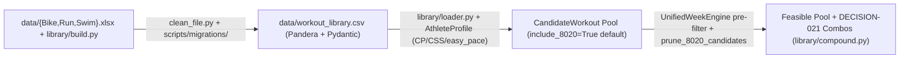

# Domain Lode: `workouts`

## 1. Scope & Responsibility
Single validated canonical workout library (`ADR-014`), 80/20 7-zone power/pace/HR modeling, dynamic distance-to-duration/TSS materialization for mile-based runs and pool swims, authored strength/long-course/gap-fill/brick catalogs, and lift+easy cardio combo synthesis (`DECISION-021`).

## 2. Key Modules & Entrypoints
- [`data/workout_library.csv`](file:///C:/Users/drisc/PycharmProjects/triathlon_planning/data/workout_library.csv): Single validated canonical workout catalog (585 rows: 80/20 scrape rows + hand-coded core + agent-authored rows; explicit boolean flags and provenance). Raw scrape cache: `data/{Bike,Run,Swim}.xlsx`.
- [`src/triplan/library/schema.py`](file:///C:/Users/drisc/PycharmProjects/triathlon_planning/src/triplan/library/schema.py): Pydantic `Workout` model, Pandera `WORKOUT_TABLE_SCHEMA`, 7-zone minute/distance column contracts, `Sport`, `Provenance`, `SplitGroup`, and brick run-leg columns (`brick_run_min`, `brick_run_strain`, `is_brick_run_hard`; `ADR-030`).
- [`src/triplan/library/clean_file.py`](file:///C:/Users/drisc/PycharmProjects/triathlon_planning/src/triplan/library/clean_file.py): 80/20 `.xlsx`/HTML parser, mile/swim prescription parsers, `calculate_TSS()`, `calculate_sTSS()`, and `refresh_from_8020_scrape()` (preserving `agent_authored` and hand-coded rows).
- [`src/triplan/library/build.py`](file:///C:/Users/drisc/PycharmProjects/triathlon_planning/src/triplan/library/build.py): Deterministic generators for authored rows (`HEAVY_VARIANTS`, `LONG_RUN_SPECS`, `LONG_RIDE_SPECS`, `GAP_ENDURANCE_SPECS`, `GAP_STRENGTH_SPECS`, `SHORT_BRICK_SPECS`, `power_tss`, `endurance_flags`, `endurance_loads`, `strength_loads`, `brick_run_loads`), invoked by idempotent migrations in `scripts/migrations/`.
- [`src/triplan/library/intervals.py`](file:///C:/Users/drisc/PycharmProjects/triathlon_planning/src/triplan/library/intervals.py): `interval_features()` / `parse_segments()` (ordered-interval parser, validated against stored zone minutes), `durability_from_features()` (one `0..10` scale), `apply_interval_features()` (`TASK-023`, `ADR-036`); columns `t_thr_min`, `t_cont_min`, `late_min` plus the derived `durability_score`. Idempotent migration: `scripts/migrations/m2026_11_19_interval_durability.py`. New rows must go through `endurance_loads(..., description=...)` or `apply_interval_features()`.
- [`src/triplan/library/loader.py`](file:///C:/Users/drisc/PycharmProjects/triathlon_planning/src/triplan/library/loader.py) & [`src/triplan/library/candidates.py`](file:///C:/Users/drisc/PycharmProjects/triathlon_planning/src/triplan/library/candidates.py): `load_library()` / `load_candidates()` (dynamically re-materializes distance-prescribed runs and swims against `AthleteProfile`), `build_default_candidate_library(include_8020=True)`, and `build_hybrid_candidate_library(include_8020=True)` (`ADR-029`).
- [`src/triplan/library/compound.py`](file:///C:/Users/drisc/PycharmProjects/triathlon_planning/src/triplan/library/compound.py): `make_lift_easy_combos()` synthesizing `DECISION-021` strength + `<= 20 min` Z1/Z2 Bike/Run compound candidates.
- [`src/triplan/library/util.py`](file:///C:/Users/drisc/PycharmProjects/triathlon_planning/src/triplan/library/util.py): Legacy DataFrame helpers (`load_workouts()`, `calculate_plan_score()` reporting metric).

## 3. Core Workflow: From Raw Sources to Solver Candidates

1. **Canonical Storage & Explicit Flags (`ADR-014`):** All workouts reside in `data/workout_library.csv` validated by `WORKOUT_TABLE_SCHEMA` (unique `code`, valid enums, 7-zone sum within `1.0 min` of `duration_min`, `tss > 0`, explicit flags). Solve-time substring guessing (`enrich_workouts_from_df`) is permanently retired.
2. **Profile-Driven Distance Materialization (`TASK-012`, `TASK-013`):**
   - **Mile-prescribed long runs** (`RL*` series, 28 rows) store `z*_dist` in miles and convert to duration/TSS at load time using `AthleteProfile.easy_run_pace_min_per_mile` scaled by 80/20 zone power ratios.
   - **Distance-prescribed swims** (71 80/20 swims) re-derive active duration and cubic-drag `sTSS` at load time from `AthleteProfile.swim_css` and `swim_pool_length`.
   - **Time-prescribed Bike/Run workouts** compute `normalized_power = intensity_factor * CP` from the active profile's manual `bike_cp` / `run_cp`.
3. **80/20 Pool Inclusion & Audit Discipline (`ADR-029`, `EXP-009`, `HEUR-008`):**
   - `load_candidates(library="default"|"hybrid", include_8020=True)` includes core `lib_default` / `lib_hybrid` rows **plus** `8020_library` workouts by default (`include_8020=False` remains available for core-only checks). Inside the engine, `prune_8020_candidates` drops near-duplicates of core rows and retains stratified representatives (`easy=6, tempo=4, hi=4`) per sport (`optimizer` domain).
   - **Pick-Audit Rule (`HEUR-008`):** Every new `lib_default` row must be justified by non-zero picks and an acceptable solve-time delta across the 8-season matrix (`EXP-008`).

## 4. Canonical 80/20 7-Zone Scale & Authored Catalogs

### A. Canonical 80/20 7-Zone Power Scale (`ADR-009`)
Commercial 5-zone systems place Zone 2 across $LT_1$ into the moderate grey zone. All prescriptions and planned analyses use the **80/20 7-Zone Scale** anchored to verified Critical Power ($CP$):

| Zone | Physiological Role | Run Power (% Stryd CP) | Bike Power (% Bike CP) | Optimizer Bucket | ANS Cost Weight |
|---|---|---|---|---|---|
| **Zone 1** | Active Recovery / Low Aerobic | 50% – 76% | 50% – 70% | Low (`z1_z2_dur`) | **0.0** |
| **Zone 2** | Aerobic Endurance (Ceiling = $LT_1$) | 76% – 88% | 70% – 83% | Low (`z1_z2_dur`) | **0.0** |
| **Zone X** | Moderate Drift Grey Zone *(Penalize)* | 88% – 94% | 83% – 91% | Grey Drift (`zx_dur`) | **0.7** (Unplanned Penalty) |
| **Zone 3** | Sub-Threshold / Tempo (Ceiling = $LT_2$) | 94% – 100% | 91% – 100% | Moderate/High (`z3_dur`) | **1.0** |
| **Zone Y** | Threshold Over-Reach Gap *(Penalize)* | 100% – 103% | 100% – 102% | High (`z4_dur`) | **1.4** (Gap Penalty) |
| **Zone 4** | Supra-Threshold / $\text{VO}_2\text{max}$ | 103% – 120% | 102% – 110% | High (`z4_dur`) | **1.8** |
| **Zone 5** | Anaerobic / Repetition ($W'$ Depletion) | > 120% | > 110% | High (`z5_dur`) | **3.5** |

- **Alactic Strides Exemption:** Alactic strides ($\le 15\text{–}20\text{s}$) in Zone 5 rely on ATP-PCr without glycolytic metabolite accumulation and receive **0.0** ANS penalty when `has_strides=True`.
- **TID Archetypes:** Polarized (~80% Z1–Z2 / 4%–6% Z3 / 14%–16% Z4–Z5 for Sprint/Olympic & Base) vs Pyramidal (~75%–78% Z1–Z2 / 15%–20% Z3 / 4%–7% Z4–Z5 for 70.3/IM Specific Build).

### B. Authored Workout Families in `data/workout_library.csv`
1. **Strength (`TASK-028`, `TASK-033`, `DECISION-022`):**
   - *Core Barbell / Hybrid:* `STR_AA1`, `STR_MS1_HEAVY`, `STR_MS2_HEAVY` (conventional DL, no trap bar), `STR_SM1_MAINT`, `STR_SM2_MAINT`, `STR_PLYO1`, `STR_UPPER_HYP` (DB rear-delt fly, no bands), `STR_LOWER_UNI`, `STR_POST_CORE`, `STR_DELOAD` (prone Y-T-W, no bands), and `STR_PREHAB_25` (`TASK-051`). All lb loads are 5 lb multiples with dumbbells `<= 75 lb`.
   - *Cap-Compatible Heavy Lifts (`TASK-033`):* `STR_HV1_SQUAT`, `STR_HV2_DEADLIFT`, `STR_HV3_SQUAT_SL`, `STR_HV4_DEADLIFT_SL` (87.5% 1RM main lift, `<= 3` heavy lower barbell sets, axial `53–62` / neuro `66–73`) so heavy lifting schedules cleanly under `CURRENT_ATHLETE`'s `65 / 75` daily caps.
2. **Long-Course Endurance (`TASK-040`, `ADR-024`):**
   - `RUN_LC_Z2_90/105/120/150` (`is_long_run`, `is_heavy_run`, 100% Z1/Z2) and outdoor rides `BIKE_LC_OUT_210/240/300/360`. Profiles whose daily caps cannot host them drop them pre-solve (`control/periodization.py::drop_unhostable_long_sessions`).
3. **Gap-Fill Core Sessions (`TASK-051`, `EXP-008`):**
   - 14 `lib_default` sessions filling short-duration and dual-purpose gaps: `RUN_AE1_15/20`, `RUN_AE1_STR25`, `BIKE_AE1_20`, `BIKE_AE2_120`, `BIKE_AE2_OUT_120`, `BIKE_TE_Z3_45`, `BIKE_TH_45`, `BIKE_TH_STR_45`, `BIKE_TE_Z3_STR_45` (hard + cadence bursts counted as strides), `SWIM_AE1_20/40`, `SWIM_AE2_65`, `STR_PREHAB_25`.
4. **Bricks & Explicit Run-Leg Schema (`TASK-059`, `ADR-030`):**
   - All `Brick` rows declare `brick_run_min`, `brick_run_strain`, and `is_brick_run_hard` (0 for Swim→Bike `SW_T1_BRICK`; computed for Bike→Run bricks including the 3 short default bricks `BRICK_AE_45_30B_15R`, `BRICK_AE_60_45B_15R`, `BRICK_TH_60_40B_20R`).

<!-- LODE_AUTOGEN_START -->
<!-- Auto-rendered by lodectx.py sync-docs; edit narrative sections above, not this block. -->

## Registered Lineage (`workouts`)

### Active Architectural Decisions (`ADR`)
- **`ADR-014` — Adopt Single Validated Canonical Workout Library and YAML Athlete Profile:** All workouts live in data/workout_library.csv (Pandera+Pydantic, explicit flags); the athlete lives in config/athlete_profile.yaml. Never infer flags at solve time.
- **`ADR-024` — Long-Course Library Rows, Profile-Level 48h Caps Bounded By The Charter:** Long Z1/Z2 runs (90-150) and rides (210-360) live in the library; 48h TSS/strain caps are profile fields validated <= the charter ceilings, never looser.
- **`ADR-029` — Include 80/20 Endurance Library Options in Default and Hybrid MILP Pools:** Default and hybrid MILP candidate builders include 8020_library workouts by default, pruned per-week by feasibility and stratified duration/intensity buckets.

### Active Operational Heuristics (`HEUR`)
- **`HEUR-003` — Specify Openpyxl Engine Explicitly in pandas read_excel:** Always pass engine='openpyxl' to pd.read_excel to prevent xlrd failures on .xlsx workout databases.
- **`HEUR-008` — A New Default-Library Row Must Be Picked In The Season Matrix:** Never add a lib_default row without a season-matrix pick count and wall-time delta; drop rows never picked: each costs solve time (EXP-008).

### Empirical Experiments (`EXP`)
- **`EXP-008` [`ACTIVE` | `TIER_1_ISOLATED`] — Per-Sport Library Gap Audit Against Solver Demand:** The season solver sees only 38 lib_default rows; 14 audited gap-fill rows cut CURRENT_ATHLETE relaxations 25-30% and single-run weeks 44-62%, at +50-90% wall time on CURRENT_ATHLETE.
- **`EXP-009` [`ACTIVE` | `TIER_1_ISOLATED`] — Include 80/20 Endurance Library Options in Default and Hybrid MILP Pools:** Including pruned feasible 8020_library options in default/hybrid pools keeps 0 fallback/0 violations across all 8 seasons and lets MILP pick 80/20 sessions.
<!-- LODE_AUTOGEN_END -->
